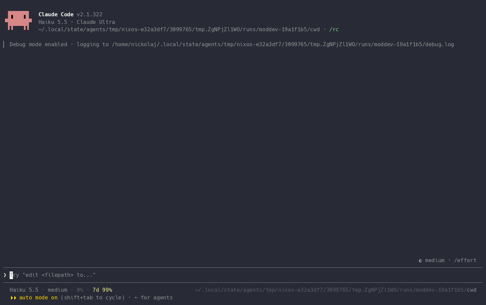
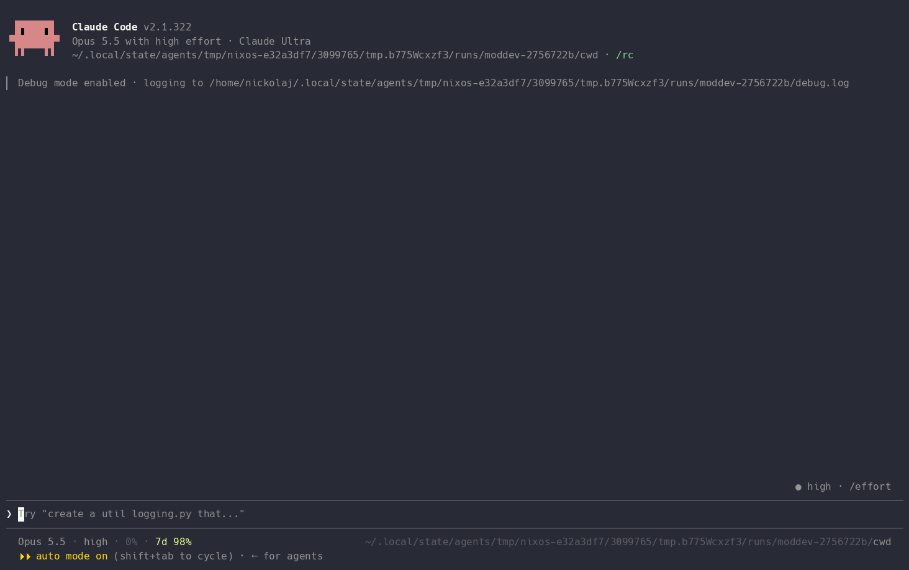

# agent-tools

Plugins for [Claude Code](https://claude.com/claude-code), for the
[pi](https://github.com/earendil-works/pi) coding agent, or for both, and agent skills for any
agent that reads them. On my own machines home-manager installs these same folders,
so what's published here is what I run.

- [Install](#install)
- [Plugins](#plugins)
- [Skills](#skills)
- [Development](#development)

## Install

```bash
claude plugin marketplace add nickolaj-jepsen/nixos
claude plugin install linear-issue@nickolaj-jepsen
claude plugin install answer@nickolaj-jepsen
claude plugin install git-menu@nickolaj-jepsen
claude plugin install spellfix@nickolaj-jepsen
```

The skills, all of them or one by its subpath, with [`npx skills`](https://github.com/vercel-labs/skills)
or as one Claude Code plugin:

```bash
npx skills add nickolaj-jepsen/nixos
npx skills add https://github.com/nickolaj-jepsen/nixos/tree/main/agent-tools/skills/land
claude plugin install skills@nickolaj-jepsen
```

My nix build tests each plugin against the Claude Code version it ships with. A
marketplace install gets no such check, so a Claude Code update can break one.

## Plugins

### linear-issue

Turns a thought, or something Claude Code flagged, into a Linear issue you approve
before it's filed.



- `/linear [what to file]` drafts from your note, or from the recent conversation
  when the note is empty.
- The You should know card gets a **Linear issue** button (usually `3`) once you
  press Learn more, which drafts from the card's insight.
- The draft fills in title, description, team, priority, status and labels; every
  field is editable.
- An open issue that already covers it adds a **Comment on KEY-123** choice.
- **Create**, or **Create & open** in the browser.
- `Esc` hides the draft to a chip above the prompt: `8` reopens it, `9` twice
  discards it.

Needs a Linear MCP server, connected and signed in.

<details>
<summary>Demo: drafting with <code>/linear</code></summary>



</details>

### git-menu

`/git` opens the checkout's repository, branch, commit or pull
request on GitHub, GitLab or Codeberg, links the compare page for a new pull
request, and copies the branch, SHA or PR URL; `/open` hands the checkout to
VS Code, Sublime Merge, the file manager or Ghostty, `/open plan` lists the
checkout's notes (`.agents/store`) for the editor, and `/open diff` opens
[tuicr](https://github.com/agavra/tuicr) on the changes in a new Ghostty
window and tells the model how to read your comments back. Rows that
can't run say why. Needs `git`, `gh` for the pull request, and `tuicr` and
Ghostty for `/open diff`.

### spellfix

picks fixes for misspelled words in the prompt draft with
hunspell and Haiku. One Haiku call answers every flagged word, adds the ones
it calls correct to the personal word list, and finds real-word typos
hunspell can't (`form` for `from`). Needs `hunspell` and its dictionaries
installed; set the executable, dictionaries and personal word list in the
plugin's options (`claude plugin configure spellfix`). Its picker is
the band button above the prompt; to open it from the keyboard, bind
`app:toggleDiffNoiseFilter` in the `Global` context of
`~/.claude/keybindings.json` (I use `ctrl+q`), which works on any draft.

### answer

A form for the round of questions or numbered pick list a turn ended on, which
writes your reply into the prompt.

- A row above the prompt offers the form when a turn ends on questions; `/answer`
  or a click opens it.
- One question per screen: numbered options, plus a last entry to write your own.
- Answer with a number, `Enter` or a click, and add a note under any answer.
- `y` takes the recommendation, `m` picks several options (`Q3: A, C`).
- `h` / `l` / `s` / `r`: back, next, skip, review.
- The review writes one line per answer into the prompt, above any draft. You send
  it.
- Works with the mouse alone, and in the desktop app, VS Code and mobile with their
  own controls.
- Answers last the session: a turn a background task starts keeps them, your own
  send drops them.
- pi has the same form from the same parser (`core/forms.ts`), as its own pi package
  (`pi/`): the same keys, a double click goes on to the next question, and the form
  stands as tall as its tallest question so stepping moves nothing.

Keys, in `~/.claude/keybindings.json` (a mod can't take the keyboard itself):

```json
{
  "bindings": [
    { "context": "Chat", "bindings": { "alt+a": "abovePrompt:focus" } },
    {
      "context": "AbovePrompt",
      "bindings": { "j": "abovePrompt:next", "k": "abovePrompt:previous" }
    },
    {
      "context": "AbovePromptInput",
      "bindings": { "escape": "abovePrompt:previous" }
    }
  ]
}
```

- `alt+a` lands on the offer row, and `Enter` opens the form.
- `Esc` in a field steps back onto the form instead of out to the prompt.

Options (`claude plugin configure answer`):

- `scrollTranscript` (off): leave a question's body out of the form and scroll the
  transcript to it instead.

Load it first in `CLAUDE_CODE_PLUGIN_DIRS`: an open form takes the band above the
prompt to itself.

### transcript-tweaks

pi only. Two changes to how the transcript reads; the session you started has them,
subagents don't.

- A `▌` rule in front of each assistant reply that has text.
- A collapsed tool result is one line: status, duration, size and, for a shell
  command, the line it ended on. `edit`, `write`, failures, streaming output and
  expanded results keep pi's own rendering.

### claude-compat

pi only, session you started only. Claude Code habits in pi.

- `/clear` starts a new session, `/effort <level>` sets the thinking level.
- `/skill-name` anywhere in a prompt runs that skill, not just `/skill:name` first.
- `ctrl+s` stashes the draft and clears the editor; on an empty editor it restores
  it, and sending a prompt restores it too. One file per repository, so it
  survives `/new`, `/resume` and a restart.

### exa

pi only; subagents have it too. `exa_search` and `exa_fetch` tools over Exa, each call
capped to a share of the model's context. The key is read from the file
`PI_EXA_KEY_FILE` names (the pi leaf sets it from its age secret); with it unset the
tools fail with that message.

### lsp

pi only; subagents have it too. Appends language-server errors to `edit` and `write`
results; it declares no tools, so it costs no context until an edit breaks something.
Servers come from the JSON file `PI_LSP_SERVERS` names (the pi leaf writes it from
`fireproof.agents.lspServers`); with it unset or empty the plugin does nothing.

## Skills

### Plan, build and ship

- [handoff](skills/handoff/): writes a finished plan up as a self-contained handoff for another agent.
- [dispatch](skills/dispatch/): writes a small task's requirements, direction and references with minimal recon, not an implementation plan.
- [run-handoff](skills/run-handoff/): builds a handoff with one subagent and worktree per item, re-verifying each.
- [land](skills/land/): takes finished work to landed commits or a PR, after checks and a review gate.

### Understand and decide

- [onboard](skills/onboard/): teaches you an unfamiliar project by running it and tracing one real action.
- [compare](skills/compare/): researches a choice or a whole category and says whether to pick, keep or build, with sourced evidence.

### Clean up

- [prune-comments](skills/prune-comments/): cuts comments and docstrings down to the load-bearing why.
- [prune-churn](skills/prune-churn/): removes tests, docs and structure that must change whenever something else does.

### Harnesses

Each starts the real program and drives it with keys, screenshots and logs.

- [pi-plugin-dev](skills/pi-plugin-dev/): pi extensions, in a tmux session.
- [claude-mod-dev](skills/claude-mod-dev/): Claude Code mods, in a tmux session.
- [dms-plugin-dev](skills/dms-plugin-dev/): DankMaterialShell plugins, in a headless sway.

### Utilities

- [mermaid](skills/mermaid/): renders the Mermaid diagrams in a markdown file to SVGs.
- [pricerunner](skills/pricerunner/): searches and compares Danish prices on PriceRunner.dk.

### Modified public skills

My variants of public skills. Prefer the originals.

- [grilling](skills/grilling/): interviews you about a plan in rounds; other skills call it.
- [grill-me](skills/grill-me/): the `/grill-me` entry point to `grilling`.

Both are reworked from the latest version of [Matt Pocock's `grill-me`](https://github.com/mattpocock/skills).

- [avoid-ai-tropes](skills/avoid-ai-tropes/): finds AI writing tells in prose and rewrites them.

Its catalog comes from [tropes.fyi](https://tropes.fyi) by [ossama.is](https://ossama.is).

### In progress

Unfinished, and not ready for anyone else to use. Their frontmatter says `status: in-progress`.

- [brainstorm](skills/brainstorm/): finds an approach for a goal that has none yet.
- [ideate](skills/ideate/): finds what is worth doing with a repo or one area of it, as ranked ideas with evidence, approaches or a sourced answer.
- [tour](skills/tour/): walks you through a PR or a stack of them, one PR at a time.
- [retro](skills/retro/): improves a skill, tool or doc from what bothered you in one agent session.
- [mine](skills/mine/): answers a question about how your agents have been working from past sessions, and improves what's behind it.
- [windows-vm](skills/windows-vm/): drives a libvirt Windows guest with screenshots, keys and PowerShell.

## Development

### Layout

Laid out to be split into a repository of its own. Each `plugins/<name>/` is a
Claude Code plugin (built by `mkToolMod`), a pi package, or both. The folder says
which, and home-manager loads every one it finds (`agentToolPlugins` in `lib/`): a
Claude half has `.claude-plugin/plugin.json`, a pi half a `pi` key in `package.json`.
Only one with a Claude half goes in the marketplace and the Install section, and
`just build` fails while `.claude-plugin/marketplace.json` disagrees with the folders.

- `core/`: harness-free TypeScript shared with pi, in a single file with no imports
  and no Node or DOM APIs.
  - Tests are `core/*.spec.ts`, run by vitest (`npm test`) and by
    `pkgs/agent-tools`.
  - `claude plugin test` runs only `*.test.ts(x)`, so the two never overlap.
- `claude/`: the Claude half. It holds the hooks module, its contract `types.d.ts`
  (`plugin.json`'s `"types"`), its `*.test.tsx` for `claude plugin test`, and a
  `tsconfig.json` over the types `just dev-setup` lays, for `tsc -p claude` and the
  editor.
- `.claude-plugin/plugin.json` and `hooks/hooks.json` stay at the root: Claude Code
  reads the manifest only there, and a mod's module only from `hooks/hooks.json`'s
  `modules` (the manifest's `hooks` field takes settings-style hooks, not modules).
- `pi/`: the pi half, which the plugin's own `package.json` names under `pi`, so the
  folder is a pi package as it stands and imports `../core` directly. The session
  you started loads it, and subagents too when its `package.json` sets
  `"agentTools": {"subagents": true}`.
- A pi half imports only pi, typebox, Node and its own plugin, never the pi leaf's
  `shared/`: the two are built into different store paths.
- Plugin root: only `.claude-plugin/`, `hooks/`, `claude/`, `core/`, `pi/`, that
  `package.json` and, with a Claude half, a `tsconfig.json` that only points the
  editor at `claude/`'s project and the cores' and pi halves'. Claude Code writes a
  root `tsconfig.json` over its own types into a mod that has none, which would then
  be the nearest config for `core/` and `pi/`. The mod's install copies its own halves only, so `pi/` never
  reaches a Claude Code install.
- No plugin imports the agent-hub client. One that needs the hub isn't a plugin.

`tsconfig.json` is a solution file over two projects, so no plugin needs a tsconfig
for its `core/` or `pi/`: `tsconfig.core.json` holds the cores to no types at all (a
Node import there fails), and `tsconfig.pi.json` checks the pi halves and the cores'
specs with Node's types. `npm run typecheck` is `tsc -b`. A pi half type-checks
against the pi that ships, not an npm copy of it: `pkgs/agent-tools` links that pi
into its `node_modules` before `tsc`, and `just dev-setup` makes the same links for
an editor.

### Traps

None of these show up in `tsc`:

- The hooks module can't re-export `register`: the engine reads `on(...)` calls from
  the file `hooks.json` names. Point `hooks.json` at the real module.
- `claude/types.d.ts` must be self-contained, with no `import`. It restates the shapes
  `core/` owns, so `tsc -p claude` flags drift.
- No symlink can stand in for a file: the engine refuses one in a plugin ("not a
  regular file"), and an install copies only the plugin's own folder.
- A spec imports vitest, whose types bring Node's, so specs stay out of
  `tsconfig.core.json`; keep it that way or a core's Node import passes.
- vitest would read the nearest `tsconfig.json`, which for a core is the plugin's,
  over types only `just dev-setup` lays. `vitest.config.ts` passes its own
  `tsconfigRaw` so none is read.
- A pi half's imports resolve to the pi that runs only through the links
  `pkgs/agent-tools` and `just dev-setup` make; `npm install` in `agent-tools/`
  prunes them, so re-run `just dev-setup` when `npm run typecheck` starts failing to
  find `@earendil-works/*`.
- Don't add pi's packages to `agent-tools/package.json`: a physical copy drifts from
  the pi that loads the half, and the links are what keep the two in step.

### Demos

Each plugin's GIFs are recorded from a live Claude Code session. Re-record after
changing what a plugin draws or its keys:

```bash
just demo linear-issue   # or any other demos/<name>.sh
```

- `demos/record.sh` drives the session with `skills/claude-mod-dev`'s driver,
  loading the checkout's plugins, and records the GIF with asciinema and agg.
- `demos/<name>.sh` holds the steps, and may fill the session's folder first.
- A run that goes another way keeps the old GIF, so run it again.
  `linear-issue-ysk` often takes a few tries, since the side agent decides whether
  the card shows.
- Runs use your account (`linear-issue-ysk` on Haiku). A plugin needing a connector
  gets your full profile.
- Nothing is filed: Linear's write tools stay unapproved, and a run whose log shows
  one is dropped.
