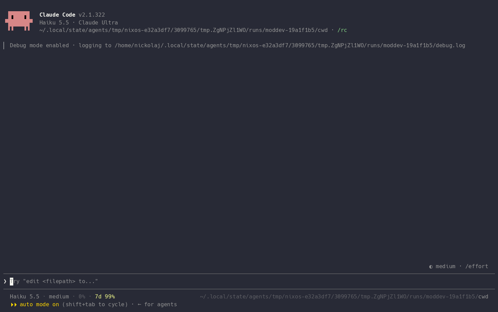
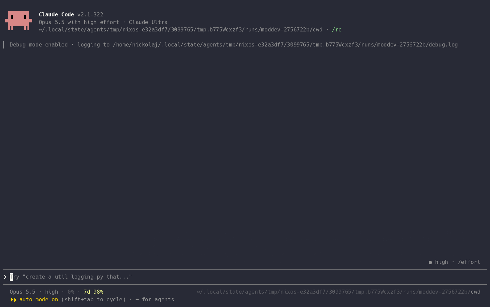

# agent-tools

Plugins for [Claude Code](https://claude.com/claude-code), some shared with the
[pi](https://github.com/earendil-works/pi) coding agent, and agent skills for any
agent that reads them. On my own machines home-manager installs these same folders,
so what's published here is what I run.

- [Install](#install)
- [Plugins](#plugins)
- [Skills](#skills)
- [Development](#development)

## Install

```bash
claude plugin marketplace add nickolaj-jepsen/nixos
claude plugin install linear-issue@nickolaj-jepsen
claude plugin install answer@nickolaj-jepsen
```

The skills, all of them or one by its subpath, with [`npx skills`](https://github.com/vercel-labs/skills)
or as one Claude Code plugin:

```bash
npx skills add nickolaj-jepsen/nixos
npx skills add https://github.com/nickolaj-jepsen/nixos/tree/main/agent-tools/skills/land
claude plugin install skills@nickolaj-jepsen
```

My nix build tests each plugin against the Claude Code version it ships with. A
marketplace install gets no such check, so a Claude Code update can break one.

## Plugins

### linear-issue

Turns a thought, or something Claude Code flagged, into a Linear issue you approve
before it's filed.



- `/linear [what to file]` drafts from your note, or from the recent conversation
  when the note is empty.
- The You should know card gets a **Linear issue** button (usually `3`) once you
  press Learn more, which drafts from the card's insight.
- The draft fills in title, description, team, priority, status and labels; every
  field is editable.
- An open issue that already covers it adds a **Comment on KEY-123** choice.
- **Create**, or **Create & open** in the browser.
- `Esc` hides the draft to a chip above the prompt: `8` reopens it, `9` twice
  discards it.

Needs a Linear MCP server, connected and signed in.

<details>
<summary>Demo: drafting with <code>/linear</code></summary>



</details>

### answer

A form for the round of questions or numbered pick list a turn ended on, which
writes your reply into the prompt.

- A row above the prompt offers the form when a turn ends on questions; `/answer`
  or a click opens it.
- One question per screen: numbered options, plus a last entry to write your own.
- Answer with a number, `Enter` or a click, and add a note under any answer.
- `y` takes the recommendation, `m` picks several options (`Q3: A, C`).
- `h` / `l` / `s` / `r`: back, next, skip, review.
- The review writes one line per answer into the prompt, above any draft. You send
  it.
- Works with the mouse alone, and in the desktop app, VS Code and mobile with their
  own controls.
- Answers last the session: a turn a background task starts keeps them, your own
  send drops them.
- pi has the same form, from the same parser (`core/forms.ts`).

Keys, in `~/.claude/keybindings.json` (a mod can't take the keyboard itself):

```json
{
  "bindings": [
    { "context": "Chat", "bindings": { "alt+a": "abovePrompt:focus" } },
    {
      "context": "AbovePrompt",
      "bindings": { "j": "abovePrompt:next", "k": "abovePrompt:previous" }
    },
    {
      "context": "AbovePromptInput",
      "bindings": { "escape": "abovePrompt:previous" }
    }
  ]
}
```

- `alt+a` lands on the offer row, and `Enter` opens the form.
- `Esc` in a field steps back onto the form instead of out to the prompt.

Options (`claude plugin configure answer`):

- `scrollTranscript` (off): leave a question's body out of the form and scroll the
  transcript to it instead.

Load it first in `CLAUDE_CODE_PLUGIN_DIRS`: an open form takes the band above the
prompt to itself.

## Skills

### Plan, build and ship

- [handoff](skills/handoff/): writes a finished plan up as a self-contained handoff for another agent.
- [dispatch](skills/dispatch/): writes a small task's requirements, direction and references with minimal recon, not an implementation plan.
- [run-handoff](skills/run-handoff/): builds a handoff with one subagent and worktree per item, re-verifying each.
- [land](skills/land/): takes finished work to landed commits or a PR, after checks and a review gate.

### Understand and decide

- [onboard](skills/onboard/): teaches you an unfamiliar project by running it and tracing one real action.
- [compare](skills/compare/): recommends one of several candidates, with researched and verified evidence.

### Clean up

- [prune-comments](skills/prune-comments/): cuts comments and docstrings down to the load-bearing why.
- [prune-churn](skills/prune-churn/): removes tests, docs and structure that must change whenever something else does.

### Harnesses

Each starts the real program and drives it with keys, screenshots and logs.

- [pi-plugin-dev](skills/pi-plugin-dev/): pi extensions, in a tmux session.
- [claude-mod-dev](skills/claude-mod-dev/): Claude Code mods, in a tmux session.
- [dms-plugin-dev](skills/dms-plugin-dev/): DankMaterialShell plugins, in a headless sway.

### Utilities

- [mermaid](skills/mermaid/): renders the Mermaid diagrams in a markdown file to SVGs.
- [pricerunner](skills/pricerunner/): searches and compares Danish prices on PriceRunner.dk.

### Modified public skills

My variants of public skills. Prefer the originals.

- [grilling](skills/grilling/): interviews you about a plan in rounds; other skills call it.
- [grill-me](skills/grill-me/): the `/grill-me` entry point to `grilling`.

Both are reworked from the latest version of [Matt Pocock's `grill-me`](https://github.com/mattpocock/skills).

- [avoid-ai-tropes](skills/avoid-ai-tropes/): finds AI writing tells in prose and rewrites them.

Its catalog comes from [tropes.fyi](https://tropes.fyi) by [ossama.is](https://ossama.is).

### In progress

Unfinished, and not ready for anyone else to use. Their frontmatter says `status: in-progress`.

- [brainstorm](skills/brainstorm/): finds an approach for a goal that has none yet.
- [ideate](skills/ideate/): ranked, verified improvement ideas for a repo or one area of it.
- [tour](skills/tour/): walks you through a PR or a stack of them, one PR at a time.
- [retro](skills/retro/): finds what went wrong in one agent session and fixes the cause.
- [mine](skills/mine/): improves a skill, tool or hook from how its past runs went.
- [windows-vm](skills/windows-vm/): drives a libvirt Windows guest with screenshots, keys and PowerShell.

## Development

### Layout

Laid out to be split into a repository of its own. Each `plugins/<name>/` is a
Claude Code plugin, built by `mkToolMod`:

- `core/`: harness-free TypeScript shared with pi, in a single file with no imports
  and no Node or DOM APIs.
  - Tests are `core/*.spec.ts`, run by vitest (`npm test`) and by
    `pkgs/agent-tools`.
  - `claude plugin test` runs only `*.test.ts(x)`, so the two never overlap.
- `claude/`: the mod, which `hooks/hooks.json` points at.
- Plugin root: only `hooks/`, `.claude-plugin/` and `types/`.
- The pi half is in `modules/programs/pi/extensions/parent/`, reading the core
  through `parent/lib/<name>`, a symlink the pi leaf replaces with a copy at build
  time.
- No plugin imports the agent-hub client. One that needs the hub isn't a plugin.

### Traps

None of these show up in `tsc`:

- The hooks module can't re-export `register`: the engine reads `on(...)` calls from
  the file `hooks.json` names. Point `hooks.json` at the real module.
- `types/index.d.ts` must be self-contained, with no `import`. It restates the shapes
  `core/` owns, so `tsc -p` flags drift.
- vitest takes the nearest `tsconfig.json`, and the plugin's one needs types only
  `just dev-setup` lays. `core/tsconfig.json` is there to be nearer.

### Demos

Each plugin's GIFs are recorded from a live Claude Code session. Re-record after
changing what a plugin draws or its keys:

```bash
just demo linear-issue   # or any other demos/<name>.sh
```

- `demos/record.sh` drives the session with `skills/claude-mod-dev`'s driver,
  loading the checkout's plugins, and records the GIF with asciinema and agg.
- `demos/<name>.sh` holds the steps, and may fill the session's folder first.
- A run that goes another way keeps the old GIF, so run it again.
  `linear-issue-ysk` often takes a few tries, since the side agent decides whether
  the card shows.
- Runs use your account (`linear-issue-ysk` on Haiku). A plugin needing a connector
  gets your full profile.
- Nothing is filed: Linear's write tools stay unapproved, and a run whose log shows
  one is dropped.
